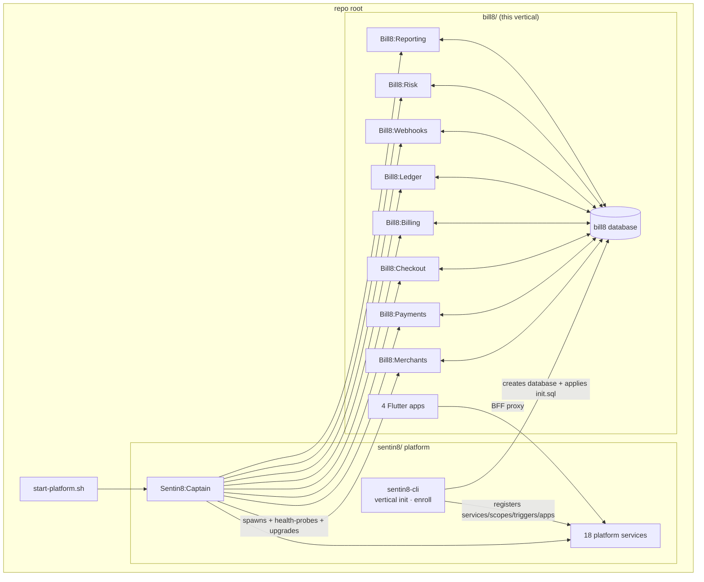
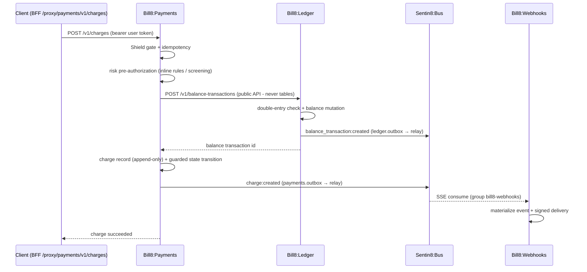
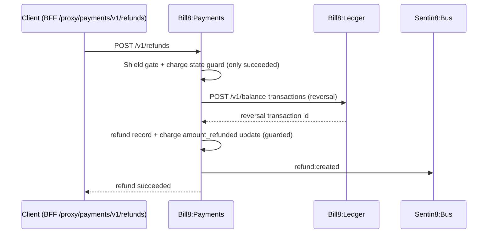
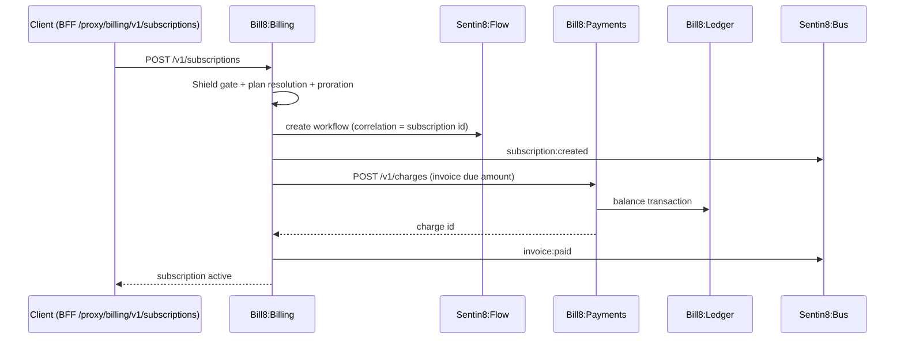
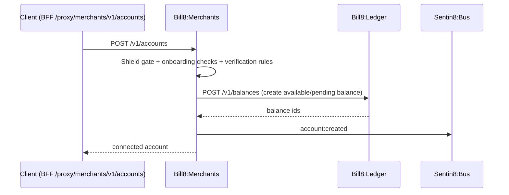
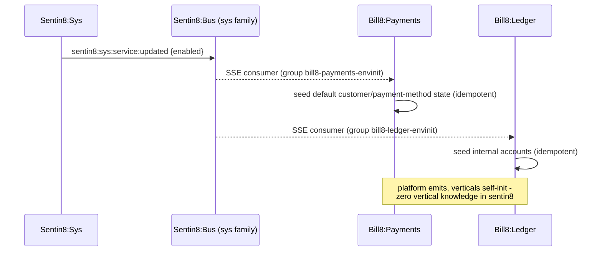
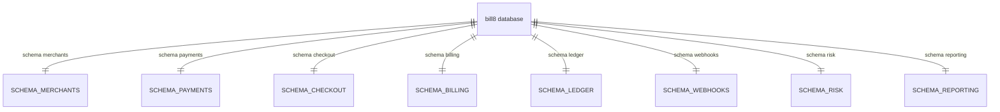
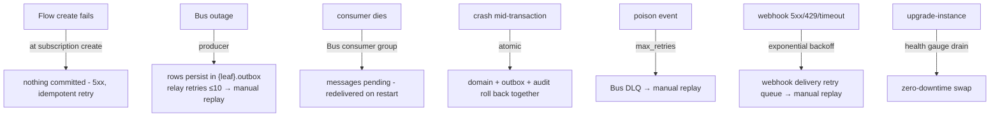
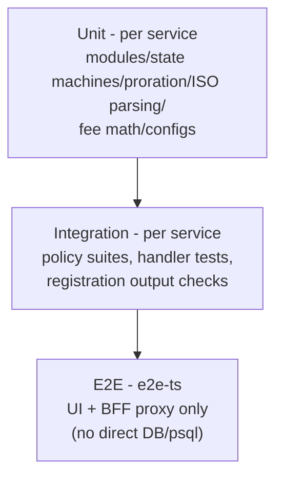

# bill8 - Detailed Design Document (Vertical)

> Secure Post-Quantum-Safe Billing & Payment Platform That Heals and Scales Itself.

Per-unit DDDs live beside each service/crate
(`services/{svc}/DESIGN.md`, `crates/*/contracts/README.md`,
`sdk/rust/bill8/README.md`). This document covers what is only visible
at the vertical level: cross-service flows, the vertical database, the
deployment lifecycle, and the vertical registration contract.

## 1. Scope & Context

The vertical owns: the `bill8` PostgreSQL **database** (created by
`sentin8-cli vertical init`), the eight services, eight contract crates,
the SDK facade, the four apps, and the runtime registrations (services,
admin scopes, event triggers, apps) installed by `vertical enroll`. It
owns no platform infrastructure.

## 2. Runtime Architecture

**Cross-service charge flow** (the vertical's main end-to-end path - no
service touches another's tables):

**Cross-service refund flow** (compensating record, money reverses
through the ledger):

**Subscription billing flow (billing → payments → ledger)**:

**Connected-account onboarding flow (merchants → ledger)**:

**Env-init (event-driven per-tenant seeding)**:

## 3. Data Model

One database (`bill8`), one schema per service (schema-per-service):

- **Schema-per-service**: each service's schema is its primary domain
  schema - `payments.charges`, `ledger.balances`, `billing.invoices`, …
  - and also carries the producer tables (`{leaf}.outbox`,
  `{leaf}.audit_journal`). Table names carry NO `{svc}_` prefix - the
  schema itself namespaces them.
- **Ownership**: each service owns exactly its schema; cross-service
  reads go through public APIs, never table grants (a cross-service grant
  is a defect); each role is granted exactly its own schema.
- **Roles**: `bill8_merchants_service`, `bill8_payments_service`,
  `bill8_checkout_service`, `bill8_billing_service`,
  `bill8_ledger_service`, `bill8_webhooks_service`,
  `bill8_risk_service`, `bill8_reporting_service` - NOBYPASSRLS,
  DSNs `postgres://{role}@…/bill8`, search_path `{leaf}, public`.
- **Producer tables**: `{leaf}.outbox` (NOTIFY `{leaf}_outbox_changed`)
  + `{leaf}.audit_journal` per service - drained by the shell's relay
  and journal pusher.
- Per-table catalogs: each `services/*/DESIGN.md` §3.

## 4. API Surface

No vertical-level API of its own - every endpoint belongs to a service
(see each DESIGN.md §4). The vertical's external contract is:

| Surface | Path prefix | Consumers |
|---|---|---|
| Merchants API | `/proxy/merchants/v1/*` | merchant, portal, admin |
| Payments API | `/proxy/payments/v1/*` | merchant, checkout, portal, admin |
| Checkout API | `/proxy/checkout/v1/*` | checkout, merchant |
| Billing API | `/proxy/billing/v1/*` | merchant, portal, admin |
| Ledger API | `/proxy/ledger/v1/*` | payments (internal), billing (internal), merchant |
| Webhooks API | `/proxy/webhooks/v1/*` | merchant, admin |
| Risk API | `/proxy/risk/v1/*` | merchant, admin, payments (internal) |
| Reporting API | `/proxy/reporting/v1/*` | merchant, admin |

**Event families** (the vertical's complete Bus surface):

| Family | Service | Stream | Key consumers |
|---|---|---|---|
| `merchants` | merchants | `bus:{env}:merchants` | ledger (balance seed), e2e |
| `payments` | payments | `bus:{env}:payments` | webhooks, billing (invoice paid), risk |
| `checkout` | checkout | `bus:{env}:checkout` | webhooks, e2e |
| `billing` | billing | `bus:{env}:billing` | webhooks, payments (invoice charges) |
| `ledger` | ledger | `bus:{env}:ledger` | payments (balance callbacks), billing, webhooks |
| `webhooks` | webhooks | `bus:{env}:webhooks` | e2e |
| `risk` | risk | `bus:{env}:risk` | payments (review resolution), webhooks |
| `reporting` | reporting | `bus:{env}:reporting` | webhooks, e2e |
| `sys` (platform) | consumed | `bus:{env}:sys` | payments/ledger/billing env-init consumers |

**Vertical registration** (`vertical-registry.json` +
`--print-registration`): services ×8, apps ×4, event triggers (charge →
webhook materialization; sys service-updated → env-init),
per-service `admin_scopes`/`policies`/`m2m_grants`/`pg_roles`/
`sql_migrations`.

## 5. Cross-Cutting Concerns

- **Authorization**: every service embeds the Shield engine
  (shell-booted); step 5 is the only gate; scope-mirror sets seed
  enforced at enroll.
- **Tenant isolation**: `env_id` RLS everywhere + explicit
  `WHERE env_id` clauses; holder scoping on customer-held tables.
- **M2M**: certificate identity per workload, declared grants in each
  service's `m2m_grants` section.
- **Audit**: local journal → Sys pusher; domain audit tables per service.
- **Idempotency**: charge/payout/invoice `(env_id, idempotency_key)`
  unique; outbox row id = Bus produce key; worker terminal-state guards.
- **TLS**: in-process PQ-TLS; `X-Sentin8-*` headers are the only tenant
  source; service ports are auto-assigned (proxy is the single ingress).

## 6. Failure Modes & Recovery

Recovery ownership: Bus owns redelivery + DLQ; the shell owns relay
retry budgets; services own only guarded state transitions and
idempotent seeds. Webhooks owns its own signed-delivery retry queue.

## 7. Concurrency & Performance Model

- Pool cap 3 per service (platform `pg_pool::connect`); each consumer
  worker adds its own capped pool on the same database.
- SSE push (no polling) on every consume loop; NOTIFY + 5s safety poll
  on the relays.
- Captain auto-scale gates per service (busy 60s / idle 300s), rolling
  upgrades with drain.

## 8. Invariants, Insecure-Defaults Rejected, Unsafe Rationale

- No bill8 service ever writes another service's tables - cross-flow
  goes through public APIs or Bus events.
- Each service's role is granted exactly its own schema - one schema per
  service; no shared vertical-wide schema exists.
- No bill8 table exists outside the `bill8` database; no platform
  table outside `db sentin8` (except the registry reads granted at
  enroll).
- Every domain transaction that emits an event writes the outbox row in
  the same transaction (outbox-first), or the write is best-effort by
  explicit design.
- Charges and balance transactions are append-only; money is only moved
  through the ledger service.
- `#![forbid(unsafe_code)]` posture in the SDK; no `unsafe` in any
  service.
- Rejected defaults: shared `bill8` superuser DSN for services;
  blanket schema grants; per-handler scope checks.

## 8.1 Fleet-run scope (group operations,)

The group Makefile's `make start` boots ONLY the platform base
(`sentin8:acme, sentin8:auth, sentin8:proxy, sentin8:bus, sentin8:sys,
sentin8:bff, sentin8:web`) plus this group's services - the
`SENTIN8_SERVICES` boot pin when captain is down, the idempotent
`captain start <types>` API form when it is up. `make stop` stops only
this group's instance rows (the captain and platform stay up). The
full rule (service / group / tree-root scopes and the platform-scoped
dev reset): `design/sentin8-repository-split-design.md` §4.5.2.

## 9. Testing Strategy

- **Unit**: money/path/proration logic is pure and covered in each
  service suite.
- **Integration**: DB-backed suites per service against scratch
  databases; `--print-registration` output shape verified.
- **E2E**: the vertical's flows exercised exactly as a user through the
  UI and BFF proxy; no direct database access.

## 10. Open Questions

- Each service's `DESIGN.md` §10 lists its open items. The root
  `backlog.md` is the single story list. No phased rollouts - every
  feature is implemented once at its final target state.

---

**Architecture & Design:** bill8 and its underlying concepts were designed by [Hamid Jahanzad](https://www.linkedin.com/in/hamidjahanzad/).
