# bill8 - Billing Vertical

> Secure Post-Quantum-Safe Billing & Payment Platform That Heals and Scales Itself.

Payments, billing, and marketplace money movement: a vertical domain
composed on the Sentin8 platform - a payments engine with charge/refund/
dispute lifecycle, recurring billing with invoices and proration, hosted
checkout, connected-account onboarding and payouts, a double-entry money
engine, webhook delivery, fraud rules, and the merchant/customer/staff
Flutter apps that use them.

## 1. Summary

bill8 is the billing vertical of the Sentin8 platform: eight Rust
services (merchants, payments, checkout, billing, ledger, webhooks, risk,
reporting) that own the `bill8` PostgreSQL database, eight contract
crates, a unified Rust SDK facade, and four Flutter apps. It contains no
platform infrastructure of its own - identity, bus, storage, scheduling,
workflows, and supervision are consumed from the Sentin8 platform
services.

## 2. Motivation

A billing domain needs provable invariants: idempotent money movement,
immutable charge records, atomic refunds and payouts, tenant isolation on
every row, and auditable webhook delivery. It also needs **pluggable
rails** - merchants must choose their settlement channels (the
platform's finance vertical, external acquirers/payment platforms,
direct bank rails) without the platform re-engineering - and external
integrators need API-key access, client-side tokenization, and
published specs. Building these on shared platform services (Auth for
identity, Bus for events, Flow for orchestration, Cron for scheduling,
Func for hooks) keeps the vertical's code focused on billing rules
instead of re-implementing infrastructure, and guarantees every service
inherits the platform's authorization pipeline and audit posture.

## 3. Architecture & High-Level Design

```mermaid
graph TD
    subgraph apps["Flutter apps (user-facing)"]
        MC["merchant<br/>(operator dashboard)"]
        CO["checkout<br/>(hosted payment pages)"]
        PO["portal<br/>(customer billing)"]
        AD["admin<br/>(platform operations)"]
    end
    subgraph platform["Sentin8 platform"]
        BFF["Sentin8:BFF<br/>(token guardian)"]
        AUTH["Sentin8:Auth"]
        BUS["Sentin8:Bus"]
        FLOW["Sentin8:Flow"]
        CRON["Sentin8:Cron"]
        FUNC["Sentin8:Func"]
        STOR["Sentin8:Storage"]
        STAT["Sentin8:Stat"]
    end
    subgraph vertical["bill8 vertical"]
        MERCH["Bill8:Merchants<br/>(connected accounts)"]
        PAY["Bill8:Payments<br/>(charges/refunds/disputes)"]
        CHK["Bill8:Checkout<br/>(sessions/links)"]
        BILL["Bill8:Billing<br/>(subscriptions/invoices)"]
        LEDGER["Bill8:Ledger<br/>(balances/payouts/transfers)"]
        WEB["Bill8:Webhooks<br/>(events/delivery)"]
        RISK["Bill8:Risk<br/>(rules/screening)"]
        RPT["Bill8:Reporting<br/>(reports)"]
        SDK["bill8 SDK facade"]
        CT["contracts crates"]
        PG[("bill8 database<br/>one schema per service:<br/>merchants · payments · checkout · billing<br/>ledger · webhooks · risk · reporting")]
    end
    MC & CO & PO & AD --> BFF
    BFF -->|"user tokens /proxy/*"| MERCH & PAY & CHK & BILL & LEDGER & WEB & RISK & RPT
    MERCH & PAY & CHK & BILL & LEDGER & WEB & RISK & RPT <-->|"workload certificate / verify"| AUTH
    MERCH & PAY & CHK & BILL & LEDGER & WEB & RISK & RPT -->|"local outbox → relay"| BUS
    BILL <-->|"workflows"| FLOW
    CRON & FUNC -->|"proxy-back /v1/internal/*"| BILL & LEDGER & WEB
    MERCH & PAY & CHK & BILL & LEDGER & WEB & RISK & RPT <-->|"tables + RLS"| PG
    SDK --- CT
```

**Units**:

| Unit | Kind | Role |
|---|---|---|
| `services/merchants` | Rust service | Connected accounts: onboarding, persons, verification, account/login links, external accounts |
| `services/payments` | Rust service | Core payments: customers, payment methods, intents, charges, refunds, disputes, setup intents, tokens |
| `services/checkout` | Rust service | Hosted checkout: sessions, payment links, hosted payment pages |
| `services/billing` | Rust service | Recurring billing: products, prices, subscriptions, invoices, usage records, coupons, credits |
| `services/ledger` | Rust service | Money engine: balances, balance transactions, payouts, transfers, fee model |
| `services/webhooks` | Rust service | Event pipeline: event materialization, endpoint management, signed delivery |
| `services/risk` | Rust service | Fraud prevention: rules, velocity checks, sanctions screening, review queue |
| `services/reporting` | Rust service | Reporting: report runs, report types, scheduled reports |
| `crates/*/contracts` | Rust crates | Wire-type DTOs shared by services and SDK |
| `sdk/rust/bill8` | Rust facade | Unified namespace facade: typed clients + contracts |
| `apps/{merchant,checkout,portal,admin}` | Flutter apps | Merchant, customer, and staff experiences |
| `e2e-ts` | Playwright | UI-only end-to-end suite through the BFF proxy |

## 4. Key Traits and Data Structures

- **Namespace facade** - every crate imports as `bill8::{service}::{…}`
  (`bill8::payments::contracts::Charge`); the vertical consumes the
  platform only through `sentin8::*` (principles §2.1).
- **Immutable money records** - charges and balance transactions are
  append-only; refunds and disputes create compensating records rather
  than mutating originals, so the audit trail is always replayable.
- **Double-entry money engine** - every money movement is a balance
  transaction debiting one balance and crediting another; a batch that
  does not net to zero is rejected before any write.
- **Pluggable settlement channels** - a `ChannelAdapter` contract + a
  runtime channel registry: any rail conforming to the contract
  (platform finance, external acquirer/payment platforms, bank rails)
  registers as data + an adapter; routing is declarative (cost, method,
  geography, failover); a channel never mutates balances.
- **Event vocabulary** - `bill8:{service}:{resource}:{operation}` over
  the DBX producer path (local `{leaf}.outbox` → shell relay → Bus
  `POST /v1/produce`).
- **Scope vocabulary** - `bill8:{service}:{resource}:{action}`,
  runtime-registered via `vertical enroll` from each service's
  `--print-registration`.

## 5. Rationale, Trade-offs, and Alternatives

- **Vertical owns domain only**: identity/event fabric/storage are
  platform services - the vertical never re-implements them
  (zero compile-time vertical knowledge flows the other way, too:
  principles §4.14).
- **Database-per-vertical, schema-per-service**: each service owns its
  own schema for domain tables and its producer tables (outbox/audit
  journal) in the same schema, so the shell relay resolves them via role
  search_path `{leaf}, public`; no shared vertical-wide schema and no
  blanket cross-service grants.
- **Money engine separated from payment orchestration**: the ledger
  service owns balances and money movement; payments owns the charge
  lifecycle. Money is only ever moved through the ledger - a refund or
  payout is a ledger operation, never a shadow write elsewhere.
- **Pluggable rails over a single channel**: channel identity is
  registry data + an adapter (a channel that conforms to the
  `ChannelAdapter` contract registers without core changes); external
  adapters onboard per-channel as data, keeping core code
  vendor-agnostic.
- **Delegation over embedding**: scheduling → Sentin8:Cron, hooks →
  Sentin8:Func, orchestration → Sentin8:Flow; the services implement
  only proxy-back handlers.
- **Rejected: a monolithic "billing" service** - the eight-service split
  keeps money movement (ledger), payment orchestration (payments),
  recurring billing (billing), and connected accounts (merchants)
  separate, each with its own scopes, tables, and event families.

## 6. Internal Implementation & Invariants

- All tenant tables FORCE-RLS on `env_id`; customer-held tables add
  holder scoping (`sentin8:holder:view-all` is M2M-only).
- Money is `rust_decimal` end-to-end; JSON wire format is a string.
- Terminal states never regress (guarded updates everywhere).
- Charges and balance transactions are append-only; refunds/disputes are
  compensating records.
- M2M identity is the workload certificate (auth DESIGN §4.3f) - a
  stolen token is nothing; without the private key the handshake fails.

## 7. Unresolved Questions / Future Designs

- Each service's `DESIGN.md` §10 carries the decided directions for its
  open items; the root `backlog.md` is the live story list. Items closed
  as decisions (certification external by design, cache scopes, colon-form
  canonical) live in the design docs, not in a tracker.

---

**Architecture & Design:** bill8 and its underlying concepts were designed by [Hamid Jahanzad](https://www.linkedin.com/in/hamidjahanzad/).

## Website

The public website at **bill8.dev** lives in the sibling
`bill8-site` repo - Docusaurus v3 on `@sentin8/site-engine`, with
product/app/SDK pages and a Reference section harvested at build time
from these repositories (program design:
`../design/sentin8-websites-design.md`).
